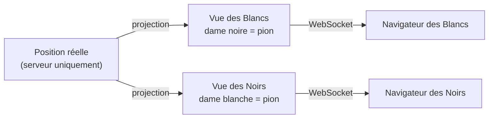

<div align="center">


# Fianchetto

**Ta plateforme d'échecs personnelle, 100 % locale : joue, apprends, progresse.**

Avec un mode inédit, **Secret Queen** : un de tes pions est une dame, et personne ne le sait.


[Secret Queen](#-secret-queen) · [Fonctionnalités](#-fonctionnalités) ·
[Démarrage](#-démarrage-rapide) · [Prise en main](#-prise-en-main) ·
[Sécurité](#-le-secret-protégé-par-construction) · [Architecture](#-architecture) ·
[Documentation](#-documentation)

</div>

---

Fianchetto tourne entièrement sur ta machine (`127.0.0.1`), avec une interface inspirée de
chess.com. Deux variantes, chacune avec son propre Elo : les **échecs classiques** et
**Secret Queen**. Autour, un **coach** complet : séance du jour, parcours par palier, leçons,
finales, puzzles, revue de tes parties par Stockfish et suivi de tes progrès. Seul accès à
Internet : l'import de tes parties chess.com, quand tu le demandes.

> [!NOTE]
> **Étapes 0 à 15 terminées** : plateforme, Secret Queen et coach (paliers 1 à 3).
> Recette et preuves : [`docs/RECETTE.md`](docs/RECETTE.md) · programme du coach :
> [`docs/PLAN-COACH.md`](docs/PLAN-COACH.md).

## ♛ Secret Queen

1. **Avant la partie**, chaque joueur désigne en secret un de ses 8 pions (30 secondes).
2. **Ce pion est une dame** : il se déplace et attaque comme une dame.
3. **Pour tout le monde, il reste un pion** : sur l'échiquier, dans les captures et dans la
   notation. Seul son propriétaire le voit, marqué d'une petite couronne ♛.
4. **À toi de démasquer** la dame adverse : un « pion » qui part en diagonale (`a2-d5`), un
   échec sans cause visible, un coup refusé…
5. **À l'écran de fin**, les deux dames sont révélées.

Règles complètes, notation publique et cas limites : [`docs/RULES.md`](docs/RULES.md).

## ✨ Fonctionnalités

L'application s'organise en six rubriques.

| Rubrique        | Ce que tu y trouves                                                                                                                                                                                                                                         |
| --------------- | ----------------------------------------------------------------------------------------------------------------------------------------------------------------------------------------------------------------------------------------------------------- |
| **Aujourd'hui** | La **séance du jour** (≈ 28 min) : révisions dues, étape du parcours, puzzles sur ta compétence la plus faible, bilan.                                                                                                                                      |
| **Jouer**       | Classique ou Secret Queen, contre un **bot à 5 niveaux** (600 à 1800 Elo, partie classée) ou **à deux sur le même écran**. Cadences 1+0, 3+2, 5+0, 10+0 ou sans pendule. **Entraînement avec le coach** et **parties lentes** (15+10, 30 min) en classique. |
| **Apprendre**   | Un **parcours en trois paliers** (1000-1200, 1200-1400, 1400-1600) : **30 leçons**, **20 chapitres de finales**, **10 parties classiques commentées**, un répertoire d'ouvertures et un **examen par palier**.                                              |
| **S'entraîner** | **Puzzles** Lichess (au niveau, par thème, révisions, tirés de tes erreurs ; classement Glicko-2), **calcul**, **révisions espacées**, finales et ouvertures.                                                                                               |
| **Mes parties** | **Revue Stockfish** de chaque coup (classe, explication, précision), revue guidée, « Apprends de tes erreurs », revue réflexive, import **PGN** ou **chess.com**, échiquier d'analyse.                                                                      |
| **Progrès**     | **14 compétences** (niveau, tendance), profil de pensée, courbes (Elo chess.com, classement puzzle, précision), classement des joueurs.                                                                                                                     |

Et partout : thèmes d'échiquier et jeux de pièces, sons, flèches, premoves, mode concentration,
affichage mobile.

## 🚀 Démarrage rapide

**Prérequis** : Node.js ≥ 22.12 (≥ 22.15 pour l'import des puzzles) et pnpm 10, fourni avec Node
via `corepack enable`.

```bash
pnpm install
```

```bash
pnpm dev
```

Ouvre ensuite <http://127.0.0.1:5173>, crée un compte local et clique sur **Jouer**. Le serveur
écoute sur `127.0.0.1:3001` ; les deux n'écoutent que sur la boucle locale.

Pour les puzzles, importe une fois la base Lichess (≈ 250 Mo lus en flux, 150 000 puzzles de 600
à 2000 gardés dans `data/puzzles.db`) :

```bash
pnpm puzzles:import
```

Déjà téléchargée ? Ajoute `--file chemin.csv.zst`.

## 🎮 Prise en main

### Jouer une partie

1. **Connexion → Créer un compte** : comptes locaux, mot de passe haché.
2. **Choisis la variante** en haut de l'accueil.
   - **Classique** : la partie commence tout de suite. Les coups possibles de la pièce
     sélectionnée sont marqués (désactivable dans ⚙ Réglages).
   - **Secret Queen contre le bot** : choisis le niveau, la couleur et la cadence, puis ton pion
     secret.
   - **Secret Queen à deux sur cet écran** : chacun choisit son pion à tour de rôle pendant que
     l'autre détourne le regard. En partie, maintiens « Voir ma dame secrète » pour retrouver la
     tienne.
3. **À la fin**, la revue de la partie est à un clic (et les dames sont révélées en Secret Queen).

### Au plateau

| Action                   | Geste                                                            |
| ------------------------ | ---------------------------------------------------------------- |
| Jouer un coup            | glisser-déposer ou clic-clic                                     |
| Flèche ou case surlignée | clic droit, glissé pour une flèche                               |
| Lâcher la pièce en main  | clic droit                                                       |
| Premove                  | contre le bot, en puzzles et en leçons ; clic droit pour annuler |
| Mode concentration       | ⛶                                                                |
| Routine de réflexion     | `r` (parties lentes)                                             |
| Coup précédent, suivant  | ← → (partie, puzzle, leçon, ouverture, revue, analyse)           |
| Fin, début               | ↑ ↓ (ou Fin, Début en revue et analyse)                          |
| Retourner l'échiquier    | `f`                                                              |
| Afficher la menace       | `x`                                                              |

Premoves, coups possibles et garde-fou du coach se désactivent dans ⚙ Réglages.

### Revoir et analyser

- **Revue de partie** (bouton de fin de partie, ou 📊 dans le profil) : Stockfish classe chaque
  coup et explique les imprécisions (?!), erreurs (?) et gaffes (??) avec flèches, cases marquées
  et « ▶ Voir la ligne ». Précision des deux camps.
- **Plateau jouable** : explore des variantes, active le **Moteur** (3 lignes cliquables) et la
  **Menace**.
- **▶ Revue guidée** parcourt les moments clés avec le coach ; **Apprends de tes erreurs** te
  fait retrouver le bon coup ; **↺ Rejouer d'ici** relance la partie avant ton erreur.
- **Revue réflexive** : avant le moteur, tu marques tes moments d'hésitation et leur cause ; ton
  profil de pensée s'affiche dans Progrès.
- **Mes parties** : importe tes parties chess.com (ton pseudo, 20 à 100 dernières) ou un fichier
  PGN, puis « Tout analyser ». L'onglet **Échiquier d'analyse** charge une FEN ou un PGN.

### S'entraîner avec le coach

- **Entraînement contre le bot** (Jouer → Classique → Contre le bot → « Entraînement avec le
  coach ») : partie non classée, sans pendule. 💡 Indice en trois clics (l'idée, la pièce, le
  coup), ↶ reprise de coup, et « Es-tu sûr ? » avant une gaffe. À la fin, le **bilan du coach** :
  trois moments clés et un conseil.
- **Partie coachée** (réglage actif par défaut, jamais en Secret Queen) : quand une de tes pièces
  est menacée ou qu'une pièce adverse est en prise, le coach te fait désigner les cases avant de
  jouer.
- **Parties lentes** (15+10 ou 30 min, contre le bot, non classées) : routine de réflexion en un
  clic et bilan du temps passé sur tes erreurs.

### Apprendre et réviser

- **Leçons** : lis la leçon, suis la partie commentée coup par coup, puis fais les exercices
  (trouver le coup ou désigner des cases), avec des **indices progressifs**. Validation à 80 % ;
  un exercice réussi avec indice ne compte pas du premier coup.
- **Finales** : chaque chapitre enchaîne le cours (pas à pas et quiz) et une partie contre le
  moteur, avec indices et limite de coups.
- **Calcul** : plateau figé, tu saisis ta ligne de 1 à 3 coups sans bouger les pièces, puis tu
  réponds à une question.
- **Examen de palier** : 20 questions (finales, calcul, tactique, stratégie), 80 % pour valider,
  conseillé mais jamais bloquant.
- **Révisions** : exercices ratés, finales échouées et erreurs de tes parties reviennent à 1, 3,
  7, 21 puis 60 jours.

### Puzzles

| Mode            | Contenu                                                         |
| --------------- | --------------------------------------------------------------- |
| **Au niveau**   | légèrement au-dessus de ton classement puzzle                   |
| **Thème**       | fourchette, clouage, mat en 2… (le thème du jour suit ton plan) |
| **Révisions**   | les puzzles ratés reviennent après 1, 3, 7 puis 21 jours        |
| **Mes erreurs** | les positions où tu t'es trompé dans tes parties analysées      |

💡 L'indice montre la pièce à jouer ; une réussite avec indice ne compte pas au classement.

## 🔒 Le secret, protégé par construction

Le serveur garde seul la **position réelle**, où le pion choisi est une dame. Pour chaque joueur,
il calcule une **vue projetée** où la dame secrète adverse redevient un pion.



- **Aucun moteur de règles côté client** : le navigateur ne reçoit que sa vue. En Secret Queen,
  ni coups légaux, ni motif de refus.
- **`Secret<T>`** enveloppe toute donnée réelle et s'affiche « [REDACTED] » dans les logs et les
  sérialisations ; une règle ESLint dédiée contrôle chaque `expose()`.
- **Banc d'attaque** (`tests/security`) : canari dans les messages, les logs et le stockage
  navigateur, indistinguabilité de deux secrets sur 10 000 paires de parties, inspection du
  bundle.

Détails et limites assumées (base SQLite, canaux auxiliaires) : [`docs/SECURITY.md`](docs/SECURITY.md).

## 🧱 Architecture

Monorepo pnpm en TypeScript strict.

| Couche  | Technologies                                               |
| ------- | ---------------------------------------------------------- |
| Serveur | Fastify, WebSocket, SQLite (better-sqlite3), Argon2, Zod   |
| Web     | React 19, Vite, Zustand                                    |
| Moteur  | chess.js (légalité), Stockfish 19 en WASM (bot et analyse) |
| Tests   | Vitest, fast-check, Playwright                             |

```
apps/
  server/        Fastify + WebSocket : parties, pendules, comptes, Elo, SQLite, bot
  web/           React + Vite + Zustand : toute l'interface
packages/
  shared/        contrats partagés (types + schémas Zod), Secret<T>
  engine/        règles : position réelle, légalité, fins de partie, projection par joueur
  coach/         coach : classes des coups, précision, explications, leçons, finales, PGN
  bot/           bot à information imparfaite + analyse de fin de partie
tests/
  e2e/           parcours utilisateur (Playwright)
  security/      banc d'attaque : fuites du secret, règles
tools/
  eslint-plugin-secret/   règle de lint « secret/no-expose »
config/
  game.config.json        Elo (départ, K) et niveaux du bot
```

## 🛠 Commandes

| Commande              | Effet                                                                      |
| --------------------- | -------------------------------------------------------------------------- |
| `pnpm dev`            | lance le serveur et le web, avec rechargement à chaud                      |
| `pnpm check`          | formatage (Prettier), lint (ESLint), types (tsc), tests unitaires (Vitest) |
| `pnpm test`           | tests unitaires seulement                                                  |
| `pnpm test:e2e`       | tests de bout en bout (Playwright)                                         |
| `pnpm test:stress`    | tests longs (10 000 parties aléatoires, vérifications Stockfish)           |
| `pnpm verify`         | `pnpm check` puis `pnpm test:e2e`                                          |
| `pnpm format`         | formate tout le code                                                       |
| `pnpm puzzles:import` | une seule fois : base de puzzles Lichess dans `data/puzzles.db`            |

Première exécution des tests e2e : `pnpm exec playwright install chromium`. Tests d'un seul
paquet : `pnpm vitest run --project engine`.

## 🗺 Feuille de route

<details>
<summary><b>Étapes 0 à 15 terminées</b> (détail)</summary>

| Étape | Contenu                                                              | État |
| ----- | -------------------------------------------------------------------- | ---- |
| 0     | Monorepo, contrats, CI locale, journal des décisions                 | ✅   |
| 1     | Moteur (règles, projection, notation) + banc de tests de fuite       | ✅   |
| 2     | Serveur + interface : partie hot-seat complète                       | ✅   |
| 3     | Bot, comptes, Elo, pendules                                          | ✅   |
| 4     | Thèmes, sons, flèches, premoves, rejeu et analyse                    | ✅   |
| 5     | Audit de sécurité du secret, recette                                 | ✅   |
| 6     | Plateforme : variante classique, Elo par variante                    | ✅   |
| 7     | Coach : revue de partie, import PGN et chess.com                     | ✅   |
| 8     | Coach : puzzles (Lichess, thèmes, révisions, mes erreurs)            | ✅   |
| 9     | Coach : entraînement (indices, garde-fou, reprise), bilan            | ✅   |
| 10    | Coach : leçons (moteur et 10 leçons de la phase 1)                   | ✅   |
| 11    | Coach : tableau de bord                                              | ✅   |
| 12    | Interface et logo, premove partout, analyse interactive              | ✅   |
| 13    | Régularité (série, thème du jour, garde-fou dégressif)               | ✅   |
| 14    | Plateau maximal, compétences, parcours, séance, partie coachée       | ✅   |
| 15    | Finales par palier, calcul, revue réflexive, examens, parties lentes | ✅   |

</details>

## 📚 Documentation

| Document                                   | Contenu                                                |
| ------------------------------------------ | ------------------------------------------------------ |
| [`docs/SPEC.md`](docs/SPEC.md)             | cahier des charges d'origine                           |
| [`docs/RULES.md`](docs/RULES.md)           | règles de référence de Secret Queen                    |
| [`docs/SECURITY.md`](docs/SECURITY.md)     | modèle de menace du secret                             |
| [`docs/DECISIONS.md`](docs/DECISIONS.md)   | journal des décisions (prime sur les autres documents) |
| [`docs/PLAN-COACH.md`](docs/PLAN-COACH.md) | programme du coach en quatre phases                    |
| [`docs/RECETTE.md`](docs/RECETTE.md)       | recette : chaque exigence reliée à sa preuve           |

## 📜 Licence et crédits

Usage strictement personnel. Aucun asset, logo, police ni son de chess.com : le logo et
l'identité « Marine & or » sont originaux, les pièces viennent de Lichess, les puzzles de la base
Lichess (CC0) et l'analyse de Stockfish (GPLv3). Détail complet : [`CREDITS.md`](CREDITS.md).
